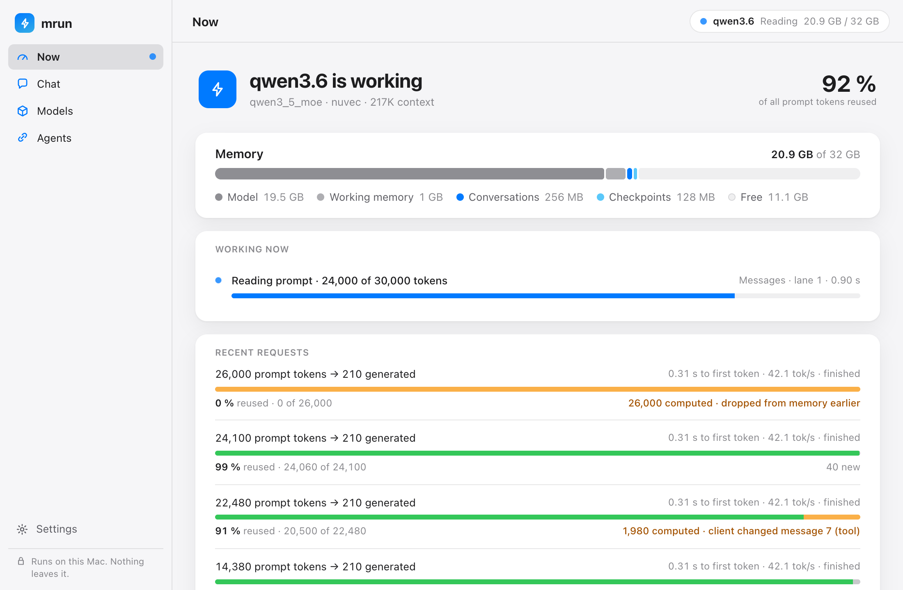
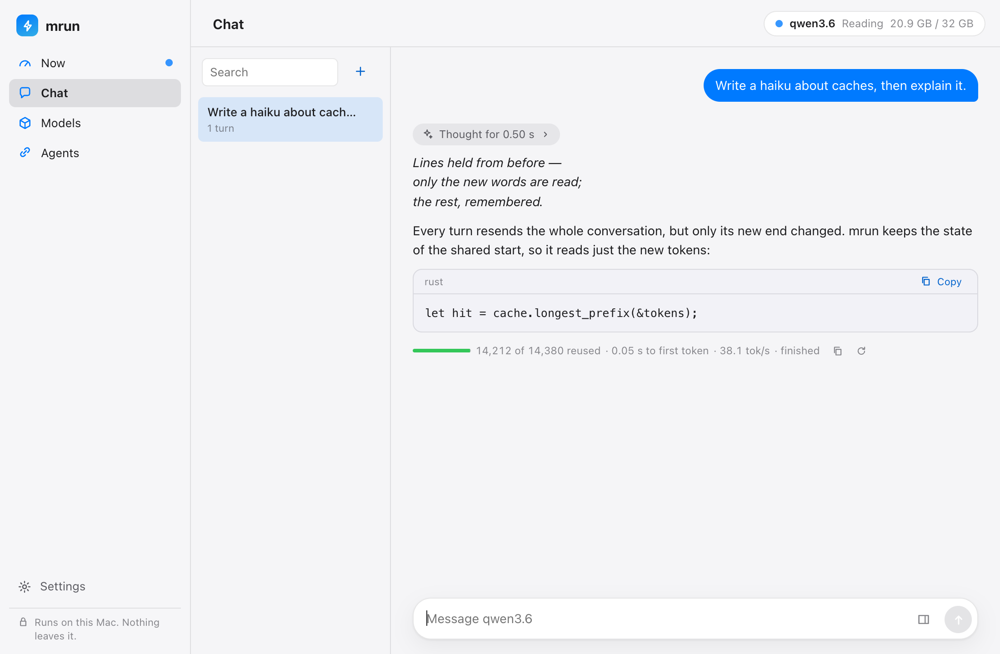
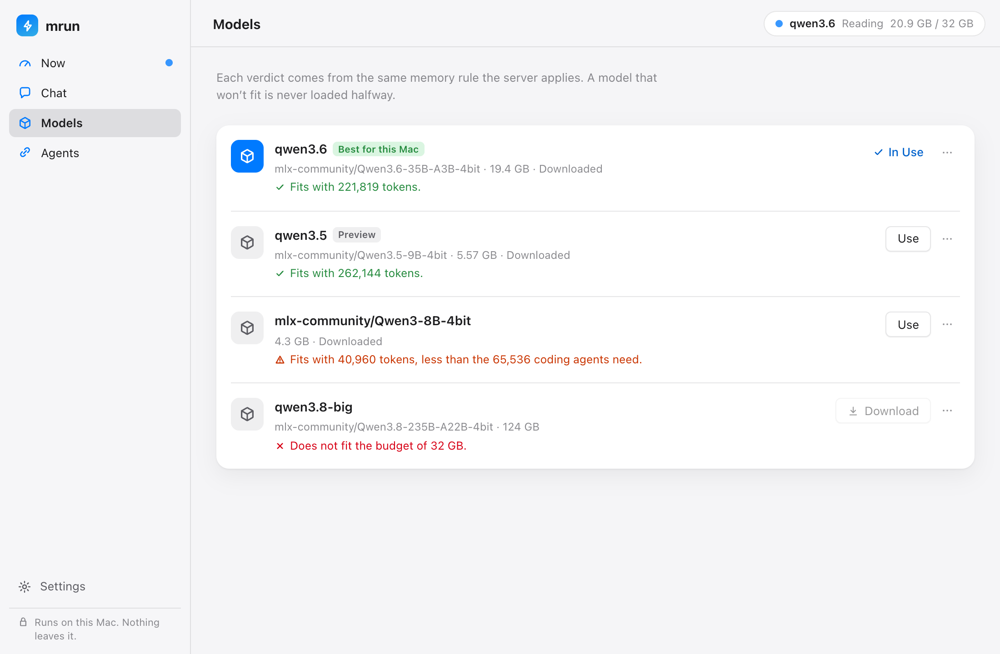
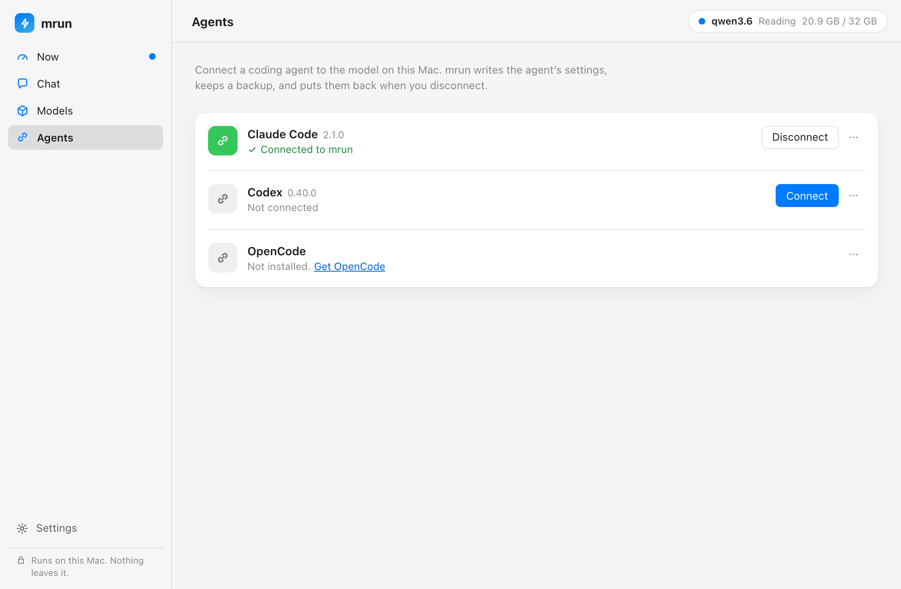
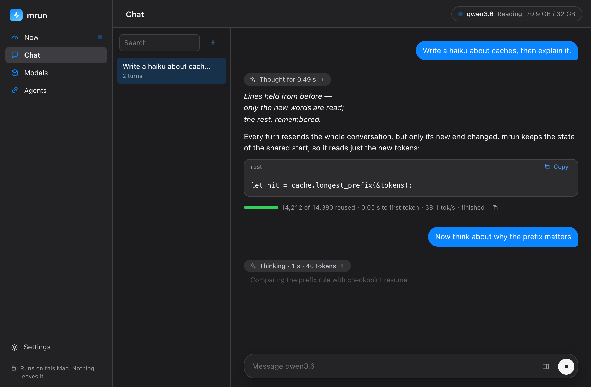

# mrun

A local inference server for coding agents on Apple Silicon (M1 and later), written in Rust on
Apple's MLX.

Coding agents resend tens of thousands of tokens of instructions, tool schemas and history on
every turn. mrun computes that context once, reuses it exactly across turns, subagents and tool
loops, explains every cache miss, and stays inside a memory budget fixed at startup. It serves
the Anthropic Messages, OpenAI Chat Completions and OpenAI Responses APIs on `127.0.0.1`, and
`mrun ui` shows all of it in a window.

[](site/static/screenshots/now.png)

**[Documentation](https://hupe1980.github.io/mrun/)** ·
[Getting started](https://hupe1980.github.io/mrun/docs/getting-started/) ·
[How it works](https://hupe1980.github.io/mrun/docs/how-it-works/) ·
[Roadmap](https://hupe1980.github.io/mrun/docs/roadmap/)

## Status

**In development; 0.1 is not released.** Build from source to try it. mrun is qualified on one
Mac (M4 Pro, 48 GB); smaller Macs are simulated there with `--budget-gib`.

- **Models**: `qwen3.6` (Qwen3.6-35B-A3B 4-bit), the default wherever it leaves at least 64K
  tokens of context, and `qwen3.5` (Qwen3.5-9B 4-bit, a preview) on smaller Macs; also Qwen3-8B
  and the Qwen3-Coder family by repo name. See [Models](https://hupe1980.github.io/mrun/docs/models/).
- **Measured**: token-for-token parity with mlx-lm, speed against mlx-lm and Ollama, and
  cancellation latency are on [Benchmarks](https://hupe1980.github.io/mrun/docs/benchmarks/).
  The client gate (Claude Code, Codex and OpenCode on scripted tasks) is on
  [Clients](https://hupe1980.github.io/mrun/docs/clients/#client-gate).
- **Before 0.1**: see the [roadmap](https://hupe1980.github.io/mrun/docs/roadmap/). Results from
  other Macs are welcome: [Hardware reports](CONTRIBUTING.md#hardware-reports).

## What mrun claims

Each claim is a release gate on the target Mac:

- **Exact reuse, proven**: a request served from the cache gets bit-identical output to
  recomputing its prompt with the same chunk plan.
- **Every miss explained**: each response reports cached and processed tokens, and a miss names
  its cause (`new`, `diverged`, `evicted`, `gap`, `disabled`) and the message where the prompt
  changed.
- **Tool loops always hit**: the model's own generated tokens are spliced back into the next
  prompt, also on hybrid models.
- **A memory budget that holds**: weights, state, cache and scratch stay inside one budget
  measured at startup, including what other apps hold. Requests that cannot fit are refused up
  front with the numbers.
- **An independent benchmark**: `mrun bench` replays whole agent sessions against other servers
  and publishes the comparison whatever it shows.

mrun does not claim the fastest decode.

## Quick start

Requirements: an Apple Silicon Mac, Xcode with the Metal toolchain
(`xcodebuild -downloadComponent MetalToolchain` on Xcode 26), CMake and the Rust toolchain pinned
in `rust-toolchain.toml`. The first build compiles MLX from sha256-pinned sources (a few minutes
to 40 minutes, depending on the machine) and caches it.

```sh
git clone https://github.com/hupe1980/mrun && cd mrun
cargo install --path crates/mrun     # or: cargo build --release (binary in target/release/mrun)

mrun ls                      # the aliases, the context each leaves here and this Mac's default
mrun pull qwen3.6            # or qwen3.5, where qwen3.6 leaves less than 64K tokens
mrun run                     # chat in the terminal
mrun serve --detach          # serve on http://127.0.0.1:8484
mrun launch claude-code      # or: codex, opencode
mrun ui                      # the window: status, chat, models, agents
```

`mrun launch` also offers to pull this Mac's default model and start the server. The binary
embeds the MLX Metal library, so no files are needed next to it. `mrun doctor` checks the
machine, the server and the clients.

## The window

`mrun ui` opens a native window and a menu bar item (`--browser` opens it in a browser): what the
server is doing, a chat that takes files and shows each reply's reuse, models with a fit verdict
for this Mac (also any repo by name), one-click agent setup, and code for your own apps. Every action is an `mrun` command, and Copy as Command shows it.
See [The mrun window](https://hupe1980.github.io/mrun/docs/ui/). Click a screenshot to enlarge it.

<table>
  <tr>
    <td><a href="site/static/screenshots/chat.png"></a></td>
    <td><a href="site/static/screenshots/models.png"></a></td>
  </tr>
  <tr>
    <td><a href="site/static/screenshots/agents.png"></a></td>
    <td><a href="site/static/screenshots/chat-thinking-dark.png"></a></td>
  </tr>
</table>

## Remote GPU (RunPod, opt-in)

For models that don't fit a Mac, `mrun cloud up --model <repo>` rents a GPU on RunPod, serves the
model there with vLLM and relays it on `127.0.0.1:8484`, so `launch` and `connect` work as usual.
**This sends your prompts and code to RunPod and costs money by the hour.** mrun shows the price
and asks first, the pod stops itself when idle, and `mrun cloud down` terminates it. See
[Remote GPU](https://hupe1980.github.io/mrun/docs/cloud/).

## Configuration

mrun needs no configuration. Defaults can be changed with flags, `MRUN_*` variables or an optional
config file, `~/.mrun/config.toml`, whose tables mirror the commands (`[serve]`, `[cloud]`, …) and
whose keys are the flag names. `mrun config show` prints every setting and where it comes from;
`mrun config schema` gives editors a JSON Schema. See
[Configuration](https://hupe1980.github.io/mrun/docs/configuration/).

## Development

```sh
cargo test --workspace --no-default-features   # engine-agnostic tests (Linux or macOS, fast)
cargo test --workspace                         # plus the MLX engine
MLX_SYS_METAL=0 cargo test --workspace         # CPU-only MLX build (no Xcode; far too slow for real models)
cargo test --workspace --no-default-features --features mrun/nuvec   # the nuvec backend instead of MLX
```

The MLX build is cached once per configuration in `MLX_SYS_CACHE_DIR` (default
`~/Library/Caches/mrun-mlx-sys` on macOS) and shared by debug, release, test builds and
worktrees; it survives `cargo clean`. Other build variables are listed in
[crates/mrun-mlx-sys/README.md](crates/mrun-mlx-sys/README.md).

The window's page lives in `crates/mrun/ui` (Svelte, built to `ui/dist`, which is committed and
embedded at build time, so Rust builds need no Node). After changing it:
`cd crates/mrun/ui && npm ci && npm test && npm run build`. `npm run shots` renders every place
in light and dark from fixed data into `ui/shots/` without a model; the screenshots in
`site/static/screenshots` come from there.

Development follows the [Spec Kit](https://github.com/github/spec-kit) workflow (`specs/`). The
website is a [Zola](https://www.getzola.org/) site in `site/` (`zola --root site serve`).

## License

MIT OR Apache-2.0; see [LICENSE-MIT](LICENSE-MIT) and [LICENSE-APACHE](LICENSE-APACHE). Model
weights keep their own licenses, shown by `mrun pull`.
