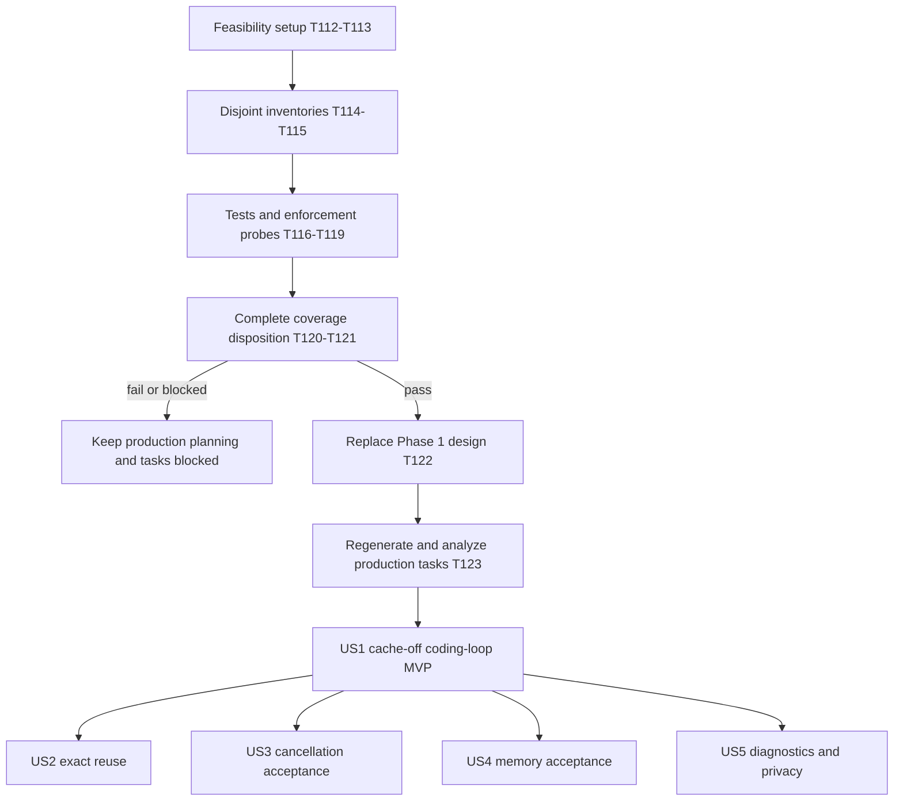
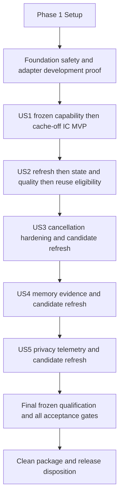

# Tasks: Prefix-Aware Interactive Agent Runtime

**Current revision**: 2026-10-14; feature `001-agent-runtime`, Git branch `main`.
**Current status**: Partial task generation: executable feasibility work only. Production story
task generation is BLOCKED by the active plan's unresolved allocation/work-bound capability gate.
This queue does not accept a production implementation plan or authorize serving.
**Current inputs**: [active plan](plan.md#current-planning-status), [specification](spec.md),
[current research](research.md#candle-replan-research-2026-10-14) and
[constitution](../../.specify/memory/constitution.md). The old data model, native contract and
quickstart are historical inputs only; their FP16/cell/sequence/CMake assumptions must not enter
the Candle design without new evidence.
**Current scope**: Rust 1.94.0, Candle core tensors, mrun-owned runtime, mistral.rs reference/
comparator only. Preserve the approved Principle V exception, derived-pressure policy and
same-core full-chat baseline. No new kernels, model downloads, tool execution, branch creation,
commits, publication or production dependency migration is authorized by these tasks.
**Numbering**: T001..T111 below remain historical, including their 17 completed markers. Continue
with T112..T124 to avoid ID reuse or claiming old completion as Candle evidence. All 13 new tasks
start unchecked. Only the new queue is active; do not resume historical T018 or later backend tasks.
**Tests**: Feasibility requires positive and rejected controls, written before the experimental
allocation implementation. A compile error, a fake ledger alone or an output/timeout limit is not
evidence that third-party allocations are bounded.

## Phase 1: Feasibility Setup

**Purpose**: Isolate the smallest experiment from the old Rust/native runtime. The experimental
package is not a second production backend, a public model or a serving bypass.

- [ ] T112 Record the baseline and experiment boundaries in `experiments/candle-budget/README.md`: preserve the current runtime manifests, existing source and historical T001..T111 completion evidence; state Rust 1.94.0, Candle candidate `c68b24997319b8d76e5a4e775dab197c7f26322a`, no model weights and no serving, and define a maximum 64 MiB experimental GPU backing reservation with per-test cleanup baselines. Record missing tools/hardware as blocked, never silently install or substitute a different backend.
- [ ] T113 Create the isolated experimental package in `experiments/candle-budget/Cargo.toml`, `experiments/candle-budget/Cargo.lock`, `experiments/candle-budget/rust-toolchain.toml` and `experiments/candle-budget/src/lib.rs`; pin Rust 1.94.0 and the candidate Candle revision, keep Metal feature-gated, freeze the resolved dependency graph and verify locked CPU/Metal builds on the stated targets. Do not change root `Cargo.toml`, `Cargo.lock`, `rust-toolchain.toml`, native code or CI to make the experiment pass; missing compiler/source provisioning remains an explicit blocker.

## Phase 2: Allocation Feasibility Foundation

**Purpose**: Establish a reviewed enforcement capability or a reproducible rejection before
production design/tasks are accepted. Failure is a useful experimental outcome, not permission
to relax FR-014 or reinterpret accounting as a hard process-RSS guarantee.

- [ ] T114 [P] Inventory every reachable GPU/backing allocation in `experiments/candle-budget/gpu-inventory.md` at the pinned Candle source: core shared/private pools and power-of-two rounding, larger pooled reuse, raw length/data/private constructors, RNG initialization, quantized upload/dequantization/readback, direct sort scratch, residency and submitted-command retains, pipeline/command metadata and foreign/no-copy imports. For each path identify the pre-allocation capacity bound, denial point, unique lease owner and safe release event; mark unsupported or unaudited paths explicitly rather than assume the core builder covers them.
- [ ] T115 [P] Inventory host allocation/work bounds in `experiments/candle-budget/host-inventory.md` for GGUF metadata/loading overlap, tokenizers 0.23.1, MiniJinja/contrib 2.24.0, LLGuidance/toktrie 1.9.1 and the existing jsonschema 0.33/serde_json direction; pin the reviewed source identities from research C-05 and include trie residency, parsing collections, template compilation/filters, tokenization, grammar construction and matcher growth. Preserve the required "64 MiB per active request; reject overflow" render/tokenize and "16 MiB per active request; reject unsupported/excess complexity" grammar/parser ceilings as targets, not established capabilities; distinguish fuel/state/output limits from pre-allocation byte limits and identify an enforceable path or decisive counterexample for each target.
- [ ] T116 Add tests-first allocation-contract probes in `experiments/candle-budget/tests/admission.rs`: instrument actual allocation-constructor entry, accept a small lawful allocation, deny insufficient reservation before constructor entry, reject arithmetic/rounding overflow, distinguish independent CPU staging from aliased CPU/GPU views, and require rollback exactly once on allocation failure. Demonstrate behavior failures against the unpatched candidate; missing symbols, compilation failure or a mock-only passing ledger cannot satisfy this task.
- [ ] T117 Implement the smallest reviewable allocation/ownership experiment in `experiments/candle-budget/patches/` and `experiments/candle-budget/src/budget.rs` using T114's inventory and T116's probes: install fallible reservation acquisition before device initialization, attach lease identity to unique backing, keep pooled/reused capacity charged and retain leases through residency/submitted work. Forbid unbudgeted raw/foreign imports in the experimental route. Prove a conservative pre-allocation backing-capacity bound rather than authorize from post-allocation Metal allocatedSize; if no defensible bound is established, record the exact failed path in `experiments/candle-budget/gpu-inventory.md` and keep the capability gate blocked. Do not patch kernels or silently alter production Candle operations.
- [ ] T118 Exercise host limits in `experiments/candle-budget/tests/host_limits.rs` and record the exact enforcement mechanism in `experiments/candle-budget/host-inventory.md`: include a lawful small template/tokenizer/schema case plus pathological compilation, filter, vocabulary/trie, optional/additional-property schema and parser-growth cases from the admitted HTTP subset. Demonstrate rejection before exceeding the stated internal byte/work reservation, not only after output growth, timeout or sampled RSS. If the selected libraries expose no enforceable path, preserve a bounded reproducer and explicit blocked outcome instead of inventing a successful allocation cap or narrowing the accepted schema subset.
- [ ] T119 Add and execute no-model Metal lifetime probes in `experiments/candle-budget/tests/metal_lifetime.rs`, within T112's 64 MiB GPU backing ceiling: test positive upload/copy/readback, independent snapshot backing, shared views, larger pooled reuse, residency retention, queued GPU work, synchronized pool cleanup, denied growth and unload returning lease counts to baseline. Instrument submitted-work lease retention and inject completion-error/uncertain-completion outcomes at the owner boundary without claiming an actual driver hang was recovered; uncertain work must quarantine backing/charges and block readiness, never release early. Report portable controls separately from real Metal outcomes.
- [ ] T120 Consolidate the experiment in `experiments/candle-budget/results.md` with source/patch/lock/toolchain identities, commands, allocation-path coverage, constructor-entry counters, positive/negative outcomes and known gaps. Require every inventoried reachable allocation and host-library path to have a reviewed bound and enforced denial before marking feasibility pass; incomplete coverage is blocked. Keep raw local artifacts separate, exclude private content, and explicitly state that no model fit, 16K context, cancellation latency, numerical quality or SC acceptance was measured. A source/patch change invalidates affected results.

**Checkpoint**: A passing T120 is feasibility evidence only. An unsupported capacity bound,
unbudgeted path, unverifiable GPU lifetime or missing required host/library control keeps planning
blocked. Experimental tasks may record a completed negative finding without making this checkpoint
pass; checkbox completion never substitutes for an explicit gate disposition.

## Phase 3: User Story 1 - Complete a Local Coding Tool Loop (Priority: P1)

**Goal**: An unmodified pinned OpenCode completes an offline read-edit-test loop with reuse off.
**Independent test**: All 20 IC cases, streamed/nonstreamed text, schema-valid single-tool handoff,
matching results, supplied fixture tests, truthful errors/terminals and no outbound inference traffic.
**Task generation**: BLOCKED; no accepted Candle implementation tasks are generated for this story.
After the design gate closes, map QualifiedModel/Request, the retained HTTP/CLI matrix and candidate
tokenizer/template/grammar path to this phase. Historical T035..T055 are not executable Candle tasks.
**Future parallel example**: Separate HTTP/stream and CLI/tool-schema test files can be written
concurrently after their shared contracts are frozen; owner, manifests and transport integration
must remain serial. No current `[P]` permission is implied.

## Phase 4: User Story 2 - Reuse Context Across Repeated Turns (Priority: P1)

**Goal**: Exact longest-token-prefix reuse with immutable independently backed snapshots.
**Independent test**: 100 mutation/branch/invalidation cases, at least 20 exact token replays,
predeclared numerical tolerances, paired SC-007 quality and SC-002 matched 8,192-prefix timing.
**Task generation**: BLOCKED; PrefixEntry ownership, retained-byte bounds and snapshot allocation
must be frozen in the replacement data model first. Do not translate native sequence IDs to tensors.
**Future parallel example**: Identity/accounting tests and branch/alias-isolation tests can use
disjoint files after the state contract is frozen; snapshot/restore/eviction integration is serial.

## Phase 5: User Story 3 - Interrupt Without Waiting for Old Work (Priority: P1)

**Goal**: Stop scheduling after cancellation and release capacity only after safe GPU completion.
**Independent test**: Queue/prefill/decode/slow-consumer races plus 100 physical trials per phase,
p95 observation-to-safe-release at most 250 ms, no leaks and a valid subsequent continuation.
**Task generation**: BLOCKED; bounded Candle calls, command completion and quarantine semantics
must be established first. No chunk size or HTTP close is evidence for the timing gate.
**Future parallel example**: Queue/terminal-race and slow-reader tests may use disjoint support
files once baseline owner interfaces exist; shared owner/output changes cannot run concurrently.

## Phase 6: User Story 4 - Stay Within a Predictable Memory Envelope (Priority: P1)

**Goal**: Enforced finite admission, pressure-aware warm residency, safe eviction and unload.
**Independent test**: Positive/negative small-budget boundaries, missing/stale observations,
derived-pressure bootstrap/recovery, pinned eviction, then 30-minute SC-005 churn and unload evidence.
**Task generation**: BLOCKED; ResourceEnvelope and reservation contracts must incorporate research
C-04 and proven allocation enforcement. Keep OS severity distinct from derived admission state.
**Future parallel example**: Observation-policy tests and unique-backing/lifecycle tests can use
disjoint files after the common lease API freezes; budget and model-owner integration is serial.

## Phase 7: User Story 5 - Understand Where Time and Memory Went (Priority: P2)

**Goal**: Reconciled local timing/token/memory metadata without private content or remote export.
**Independent test**: Frozen cold/warm/hit/miss/tool traces against independent client clocks,
token reconciliation and SC-009 log/artifact/network audits.
**Task generation**: BLOCKED; RunEvidence must bind the actual Candle/patch/profile/build and
shared backing, not old native cell counts. No prior binary's report authorizes a rebuild.
**Future parallel example**: Known-clock/token tests and privacy/traffic tests may use separate
files once schemas are frozen; shared instrumentation and status integration is serial.

## Phase 8: Planning Handoff and Cross-Cutting Review

**Purpose**: Close the research gate only from evidence, then restore the normal plan/tasks/analyze
sequence. These are planning handoff tasks, not feature completion or production authorization.

- [ ] T121 Reconcile T120's explicit outcome into `specs/001-agent-runtime/research.md` and `specs/001-agent-runtime/plan.md`: accept only complete reviewed pre-allocation/work enforcement with pinned patch and dependency identities; retain counterexamples and missing coverage as blockers. Preserve Rust 1.94.0, Candle ownership, the dated/expiring Principle V exception, approved derived-pressure semantics, full-chat same-core baseline and all FR/SC thresholds. Do not mark Phase 0 complete from an experiment checkbox, a mock ledger or a sampled peak.
- [ ] T122 Only after T121 records a passing feasibility gate, execute the planning workflow to replace `specs/001-agent-runtime/data-model.md`, `specs/001-agent-runtime/contracts/backend.md`, `specs/001-agent-runtime/contracts/http.md`, `specs/001-agent-runtime/contracts/cli.md`, `specs/001-agent-runtime/contracts/qualification.md`, `specs/001-agent-runtime/benchmark-protocol.md` and `specs/001-agent-runtime/quickstart.md` with consistent Candle entities, enforceable limits, tool/tokenizer identities, evidence invalidation and validation commands; recheck the constitution pre/post design. Leave this task unchecked while the allocation gate is blocked and do not claim model or hardware qualification from document generation.
- [ ] T123 After the replacement design passes T122, regenerate production tasks in `specs/001-agent-runtime/tasks.md` using `/speckit-tasks`, preserving completed history and IDs, and run the non-destructive `/speckit-analyze` review against `specs/001-agent-runtime/spec.md` and `specs/001-agent-runtime/plan.md`; require story labels, exact paths, verbatim frozen constraints, acyclic dependencies, disjoint parallel waves and tests before implementation. No production backend task is accepted until that review and the planning gates pass.
- [ ] T124 Record the final handoff disposition and any residual blockers in `experiments/candle-budget/results.md`: verify the experiment did not mutate production manifests/native code, persist private data, download weights or transfer old report eligibility; report future production-story task counts only from the actually regenerated queue. Keep every empirical SC gate unpassed until its separate frozen-target run and do not publish or commit as part of this task.

## Current Dependencies and Parallel Execution

T112 -> T113 -> (T114 || T115) -> T116 -> T117 -> T118 -> T119 -> T120 -> T121.
T122 requires a passing T121; T123 requires a passing replacement design; T124 follows the handoff
or records the blocked disposition without opening downstream gates. Do not run T117/T118 in
parallel: they may share the experimental budget implementation and dependency lock.
Only T114/T115 carry `[P]`, after setup, because their inventory files are disjoint. No subagent
delegation or parallel writers to shared files is implied by a future story example.

## Current Implementation Strategy and Counts

First complete the no-model feasibility experiment or document a decisive blocked result. Do not
silently accept a fork, shrink the schema subset or replace a byte budget with fuel to obtain a pass.
Then replace the design, generate/analyze production tasks and implement US1 as the first MVP,
including baseline admission, safe cancellation and truthful streaming before any serving.
Reuse remains gated on matching state/numerical/protocol/SC-007 evidence; full acceptance still
requires all nine SC gates on the physical target. Other stories retain independent test criteria
but no production execution order is accepted until their Candle interfaces are frozen.

Current active task count: **13** (setup 2, feasibility foundation 7, handoff/review 4).
Current active user-story counts: **US1=0, US2=0, US3=0, US4=0, US5=0**; generation is deferred,
not complete. Current parallel opportunity: **T114/T115 only**. Historical task count: **111**,
with **17 completed**. Do not add these historical counts to the active queue or report the
old story tasks as regenerated. The next executable task is T112, not historical T018.

## Superseded llama.cpp Tasks (Historical)

The remainder is preserved historical task text and completion state. Its permissions, prerequisites,
scope, Rust constraint, task dependencies and parallel examples are superseded by the current
queue above. It does not authorize llama.cpp implementation or represent Candle progress.

**Input**: Design documents in `specs/001-agent-runtime/`.
**Prerequisites**: [plan.md](plan.md), [spec.md](spec.md), [research.md](research.md),
[data-model.md](data-model.md), [contracts](contracts/qualification.md),
[benchmark-protocol.md](benchmark-protocol.md), [quickstart.md](quickstart.md), and
[constitution](../../.specify/memory/constitution.md).
**Status**: Implementation started 2026-10-13 after a read-only analysis with no findings.
Setup/draft fixtures and T012..T017 foundation tests, types and private native boundary are validated.
T012/T013 demonstrated behavior failures before implementation; admission/context/pressure and report
tests remain intentionally red pending T018..T026. The no-model native build/log/null-input probe
passes, not model inference, adapter feasibility or any empirical SC acceptance gate.
T018 is blocked on 2026-10-14: the mandatory `os_proc_available_memory` is marked
unavailable on macOS by SDK 26.5. The bridge remains fail-closed; dependent work is
halted pending a reviewed capacity-signal design change. See the research implementation blocker.
**Tests**: Required by the specification's acceptance scenarios and constitution. Write the
relevant positive/rejected tests first and demonstrate a meaningful failure before implementation;
a missing-file/compiler error alone is not behavioral evidence.
**Organization**: Shared prerequisites, then US1..US5 in specification order (P1/P1/P1/P1/P2).
**Scope**: One Rust package, one private pinned llama.cpp/Metal adapter, no tool execution,
custom kernels, persistence, thinking, speculation, batching or second production backend.

## Format: `[ID] [P?] [Story] Description`

- Checkboxes record validated task completion; IDs are unique and sequential.
- `[P]` means disjoint files within the stated ready wave, not permission to ignore prerequisites.
- `[US1]`..`[US5]` label story tasks; shared setup/foundation/polish tasks have no story label.
- Paths are repository-relative planned files; their presence is not asserted.
- Do not create branches, commit, publish or raise the declared Rust minimum automatically.

## Path Conventions

Use `src/`, `native/`, `tests/`, `examples/` and `.github/workflows/` from the plan.
Qualification implementation lives in `tests/support/qualification/` and is shared with
`examples/qualify.rs`; test-only adapters never become externally selectable models.
Fixtures and their licenses ship under `tests/fixtures/`. Large model artifacts stay in ignored
`models/`; raw evidence stays in ignored `benchmark-results/`. Public source, builds, fixtures,
documentation and package tests must not depend on ignored specifications or concepts.

## Phase 1: Setup (Shared Infrastructure)

**Purpose**: Extend the existing placeholder, rather than initialize another project.

- [X] T001 Extend `Cargo.toml` and review `Cargo.lock` for Tokio 1.x, Axum 0.8, Tower 0.5, Serde/serde_json 1.x, Clap 4.5, tracing 0.1, sha2 0.10 and jsonschema 0.33; select locked patches that pass Rust 1.85.0, disable validator remote/file reference resolution, keep default features native-free and gate the native route behind `metal`.
- [X] T002 Add Rust 1.85.0 with rustfmt/Clippy in `rust-toolchain.toml` and establish `src/lib.rs` module ownership for config/api/runtime/cache/budget/backend/telemetry; keep native types private and permit unsafe only in the audited private backend boundary, without exposing native handles or weakening safety outside it.
- [X] T003 Define the frozen resource profile in `src/config.rs` from the data-model table, with typed byte/token/time limits, profile identity and lower-only overrides; distinguish the 16,384 per-request context from 32,768 physical KV cells and preserve all CLI defaults in contracts/cli.md.
- [X] T004 [P] Add explicit offline native provisioning instructions in `native/README.md` for commit `45451c366d4256f94fbc8845645e31a6b9155054`, clean-source verification, arm64/macOS 15+/SDK, Apple Clang C11/C++17 and CMake 3.31.6; specify a clean-package-compatible vendor/provision procedure and audit native/model notices without hidden build-time fetches.
- [X] T005 [P] Add portable locked Rust 1.85 format/Clippy/default-free/all-target checks to `.github/workflows/ci.yml`; reserve Metal/hardware evidence for explicit qualification, never equate an arbitrary hosted macOS runner with physical M4 Pro acceptance.
- [X] T006 Establish `tests/support/mod.rs` deterministic clocks, unique temporary fixture roots, controlled pressure/fault observations and bounded fake-backend events; register the foundation support suites in `tests/foundation.rs` so `cargo test --test foundation` executes them before US1 test files exist, without process-global environment mutation or ignored planning dependencies.

**Checkpoint**: Package identity preserved, dependency lock reviewed, portable test support ready.

## Phase 2: Foundational (Blocking Prerequisites)

**Purpose**: Materialize the frozen inputs and falsify the native assumptions before production work.
The test/capability harness may operate native primitives without authorizing a public service.

- [X] T007 [P] Prepare draft IC-001..IC-020 source inputs/expected HTTP assertions and public read-edit-test workspace in `tests/fixtures/interoperability/`, with licenses/provenance; reserve actual released-client captures for T054, never invent schemas or mark draft fixtures qualified.
- [X] T008 [P] Materialize all distinct P/B/I/S/F-001..020 mutations and expected cleanup/state assertions in `tests/fixtures/state/`; record exact-reference versus unsupported-profile fake-test roles and do not satisfy category counts with repeated happy paths.
- [X] T009 [P] Materialize C-001..C-020 objective failing/passing coding fixtures in `tests/fixtures/coding/`, recording languages, supplied tests, allowed tools, time/tool ceilings, licenses and three paired seeds before optimization.
- [X] T010 [P] Prepare draft R-001..R-010 distinct ten-turn source inputs and recorded tool results in `tests/fixtures/replay/`, with expected output checks/licenses/seeds; do not generate rendered tokens until T029 after renderer construction, and do not confuse replay with live client tasks.
- [X] T011 Define draft/source/rendered manifest states in `tests/fixtures/manifest.json` and `tests/support/qualification/fixtures.rs`, requiring IC=20, state=100 with five distinct categories of 20, coding=20 and replay=10; enforce "Draft preparation needs no renderer and cannot invent rendered tokens" and "the loader rejects draft, missing or mismatched records" for dependent evidence, while permitting bounded primitive construction probes on draft inputs.
- [X] T012 [P] Add foundation budget/pressure/context positive and rejected tests in `tests/support/admission_foundation.rs`, with missing observations, shared backing, reserve-before-allocation, prompt/output growth and cleanup; demonstrate meaningful behavior failures before T015 and T018..T022, not just missing-module compile errors.
- [X] T013 [P] Add staged report/fixture lifecycle tests in `tests/support/report_contract.rs`, including lawful candidate capability and reuse records, adapter-only rejection, incomplete SC-007/protocol rejection, stale/replaced binary, draft manifests, duplicate keys, unknown versions/fields, depth/nodes/bytes and evidence-hash mismatches before T026.
- [X] T014 Define qualified artifact/profile/identity types in `src/backend/model.rs` with `model_id` "stable public name `qwen3-8b-q4-k-m`; one configured model initially", the research D-02 revision/size/SHA-256, "adapters (empty initially)", and capabilities "full attention, text-only, non-thinking, single tool call, grammar/schema subset", "context 16,384 and output maximum 2,048"; hash tokenizer/template/render/architecture/ABI/backend/build/KV/positions identities and disclose only actually qualified capabilities.
- [X] T015 Establish unique owned allocation/reservation types in `src/budget/ledger.rs` with "CPU views and GPU views of one backing have one charge" and "growth exceeding it fails safely rather than reallocating unnoticed"; support lease transfer/release-once, backing sharing/pins and conservative preallocation demand, with no RSS-derived retroactive authorization.
- [X] T016 Define the narrow owner operations and deterministic adapter in `src/backend/mod.rs` and `tests/support/backend.rs`, with native owner "private owner-thread handle; not serializable or exposed through public Rust types", including borrowed-logit copy rules, explicit status, cancellation/synchronization barriers and accounting hooks; prevent inference on Tokio workers or pointer/device-handle leakage to public types.
- [X] T017 Build the feature-gated private native boundary in `build.rs`, `native/shim/mrun.h`, `native/shim/mrun.cpp` and `src/backend/llama.rs`; verify clean pinned source, explicit Metal offload, native log suppression before load, C ABI exception containment, common Jinja/chat helpers and no server/curl/download code or silent CPU fallback.
- [ ] T018 Implement independently timestamped macOS observations in `src/budget/observations.rs` for physical sysctl, os_proc_available_memory, Metal recommendation/current allocations, proc_pid_rusage footprint/RSS and swap/pressure/pageout; keep views/units distinct and enforce "Missing observations block load/admission" before all native or product admissions.
- [ ] T019 Implement selected ceiling/delta admission in `src/budget/admission.rs`: lesser of 75% physical and available minus 8 GiB, retain the selected loaded ceiling, independently recheck additional capacity before allocations, separate Metal limits and explicit warned opt-in for budget increases; never subtract existing owned allocations twice or promise hard RSS bounds.
- [ ] T020 Integrate weight/full KV/scratch/native-host/serving preallocation leases in `src/budget/ledger.rs` and `src/backend/llama.rs` before native allocation, using unique backing IDs and conservative fit profiles; growth beyond reservation fails closed, scratch reserves at least the greater of 2 GiB or 25% of weight-plus-KV backing, and host/device views never double-charge.
- [ ] T021 Implement reusable rendered-context/output reservation in `src/budget/context.rs`: total <=16,384, output <=2,048 and configured smaller ceilings, reserve growth/temporaries/grammar/serving before evaluation, reject empty prompt/zero output and report limiting numeric allowance; US1 owner must consume this policy rather than duplicate or defer admission.
- [ ] T022 Implement pressure disposition in `src/budget/pressure.rs` with bounded owner actions: stop admissions, evict only unpinned state, cancel/synchronize/unload if still unsafe, resume only after fresh observations and explicit safe reload; wire these mandatory hooks into the US1 scheduler/owner before serving, with no privileged OS tuning or swap-as-capacity.
- [ ] T023 Implement reviewed public-fixture manifest/raw-record persistence in `tests/support/qualification/evidence.rs` before any evidence run, recording hardware/build/artifact/token/template/client/profile/settings/licenses/seeds, stage/resource outcomes and pass/fail/blocked/inconclusive dispositions; bound records and exclude private content, default token arrays and absolute paths.
- [ ] T024 Implement independent monotonic/client clocks and stage/tool/wall interval recording in `tests/support/qualification/timing.rs` before native trials, using actual token IDs and `(output_tokens-1)/(last-first)` only for >=2 tokens; retain failed/cancelled/timed-out outcomes and distinguish trigger/observation/GPU/release clocks, with HTTP instrumentation supplied by later US1/US5 hooks.
- [ ] T025 Implement preregistered protocol statistics in `tests/support/qualification/statistics.rs` before any timed gate: three warmups, 30 paired observations across >=3 sessions, recorded ABBA/balanced order, ten fresh cold processes, nearest-rank p95 and session/block-aware 95% bootstrap intervals, maximum 100 samples/cell and retained complete-cohort failures/quality counts; test arithmetic on synthetic fixed observations without claiming hardware outcomes.
- [ ] T026 Implement QualificationReport parsing/eligibility in `src/backend/qualification.rs`: schema_version "exactly 1; unknown versions and fields rejected, no permissive fallback"; stage "adapter_spike, candidate_capability, or candidate_reuse; adapter_spike never authorizes serving"; subject "exact runtime executable SHA-256 for candidate stages, backend/model/profile/render identity, fixture manifest revision/hash and build configuration"; harness "independent executable/build identity and run-scoped target binding; hashing the harness cannot substitute for exercising the selected runtime candidate"; records "evidence artifact hashes, gate dispositions and required case/trial coverage. Pass without complete matching records is invalid"; eligibility "cache-off serving only after candidate capabilities pass; production reuse only after capabilities, state/numerical, IC-001..020 and SC-007 pass for the same subject/profile"; enforce "1 MiB before parsing, JSON depth 16, 65,536 nodes, 1,024 evidence references and 4 KiB per string", duplicate/trailing-data rejection and hashed-record validation, never operator declarations or rewritten stale subject hashes.
- [ ] T027 Add capability probes in `tests/support/qualification/templates.rs` for verified GGUF metadata, frozen non-thinking/BOS/EOS/tool-order/time rendering and backend-native grammar/parser reset; enforce "64 MiB per active request; reject overflow" render temporaries and "16 MiB per active request; reject unsupported/excess complexity" grammar storage before claiming bounded support.
- [ ] T028 Implement the private selected-fixture candidate channel and primitive-only target entrypoint in `src/backend/qualification_target.rs`, `src/main.rs` and `tests/support/qualification/target.rs`, then expose adapter/seal/capability/reuse/acceptance suites in `examples/qualify.rs`; require `--runtime-binary PATH` except adapter, execute/hash that target with a separately hashed harness, restrict primitive construction to bounded draft inputs and forbid production serving/reuse authorization, arbitrary private workspaces, forged results or a product force-reuse option.
- [ ] T029 Derive exact rendered-token fixtures from the verified T027 renderer through the T028 selected executable and seal source/render/model identities in `tests/fixtures/manifest.json` using `tests/support/qualification/fixtures.rs`; enforce "Seal both source and rendered hashes before any dependent run" and "retain old manifests and rerun affected gates rather than mutate evidence in place", and reject draft/token/identity mismatches before evidence execution.
- [ ] T030 Add native geometry/sharing probes in `tests/support/qualification/state.rs`: read back `n_ctx=32768`, `n_seq_max=5`, `kv_unified=true`, `n_batch=n_ubatch=128`, FP16 K/V and flash attention off; prove sequence membership sharing, immutable branches, final-token logits replay and safe removal against actual cells, without shifting, snapshots or generated-suffix publication.
- [ ] T031 Add preallocation/fault probes in `tests/support/qualification/allocations.rs` covering actual weights/full KV/native host/scratch demand, attempted ceiling violations, asynchronous error observability and context invalidation; reserve "at least the greater of 2 GiB or 25% of weight-plus-KV backing" scratch plus enumerated demand and reject unobservable/unbounded allocation or fault recovery.
- [ ] T032 Add physical-owner cancellation/unload probes in `tests/support/qualification/cancellation.rs` for queued/prefill/decode/slow-reader boundaries, wakeable backpressure and submitted-work lifetimes; measure actual safe release, never infer Metal preemption from the CPU abort callback or a 128-token chunk.
- [ ] T033 Execute `--suite adapter` through `examples/qualify.rs` on physical M4 Pro 48 GB with sealed dependent inputs, recording sharing/replay/geometry/render/grammar/allocation/fault/unload/cancellation outcomes under `benchmark-results/adapter/`; this evidence permits continued development only, never production serving or reuse.
- [ ] T034 Run `cargo test --test foundation` and record its admission/report/fixture regressions plus T033 adapter feasibility in `specs/001-agent-runtime/research.md` and `specs/001-agent-runtime/plan.md`; stop before production story work on unsafe/unsupported capabilities or failed foundational controls, require reviewed selection/design changes rather than weaker thresholds, and leave every SC gate empirically unpassed until its own run.

**Checkpoint**: Passing adapter feasibility and deterministic foundation regressions permit story
implementation only. Observations, admission, preallocation, context/output reservations and pressure
controls already exist; spikes and ledger types cannot replace them. No production report exists yet.
Missing physical host/artifacts mean blocked, not fake qualification. Run `/speckit-analyze` first.

## Phase 3: User Story 1 - Complete a Local Coding Tool Loop (Priority: P1)

**Goal**: An unmodified pinned client completes a correct offline read-edit-test loop with reuse off.
**Independent Test**: All 20 IC cases plus released OpenCode v1.19.0 IC-020; verify exact captures,
schema-valid handoff/result IDs, objective fixture tests, no partial-call execution or outbound traffic.

### Tests for User Story 1

- [ ] T035 [P] [US1] Add IC text/nonstream/stream/UTF-8/usage/finish/error reconstruction tests in `tests/contract.rs`, including HTTP field rejection, length-versus-tool-failure and no success terminal after transport/native failure; use deterministic backend observations before implementing production responses.
- [ ] T036 [P] [US1] Add schema/history/required/named/none selection and final-validation tests in `tests/support/tool_contract.rs`, including absent tool declarations, orphan/duplicate results, unsupported schemas, escaped argument fragments and a client observer that never executes partial calls.
- [ ] T037 [P] [US1] Add CLI/config/report authorization tests in `tests/support/cli_contract.rs` for lower-only bounds, literal loopback, sanitized exit codes, adapter-report rejection, exact executable replacement/rebuild, missing protocol/SC-007 and explicit reuse-on rejection; default off without reuse eligibility must expose its status without pretending qualification.

### Implementation for User Story 1

- [ ] T038 [US1] Implement strict request/history types in `src/api/request.rs` using the complete HTTP matrix: reject duplicate keys/trailing JSON/invalid UTF-8/unknown nested fields and null except permitted assistant content; freeze request scope as "server OS uid and process boot epoch" and never let caller IDs select it.
- [ ] T039 [US1] Implement generation validation in `src/api/validation.rs` for messages 1..512, max_tokens 1..2048/default 2048, temperature 0..2/default 0.7, top_p (0,1]/default 0.8, penalties [-2,2], seed 0..4294967295, user <=128 bytes and stop limits "At most 4, each <=256 UTF-8 bytes; matcher/carry included in output lease"; reject empty render, zero output and unsupported thinking/media/parallel/options before execution.
- [ ] T040 [US1] Implement schema/tool history validation in `src/api/tools.rs` with native grammar plus jsonschema, exact allowed keywords/types/facets and disjoint-type anyOf; enforce "512/64; schema depth 8, JSON nesting 32", "32 KiB per tool, 256 KiB total, 4,096 schema nodes total", tool names `[A-Za-z0-9_-]{1,64}`, descriptions <=8 KiB and call IDs <=128 bytes, and require exactly one matching result per outstanding declared call without schema rewriting.
- [ ] T041 [US1] Implement verified opened-file/model metadata admission in `src/backend/artifact.rs`: require primary byte length/SHA-256/revision, unchanged stat identity while mapped and trusted provisioning, invalidate replacement/reload identity, and reject unsupported architecture/format/accelerator without downloads or hidden fallback.
- [ ] T042 [US1] Implement native-owner cache-off rendering/prefill/decode in `src/runtime/owner.rs`, integrating the foundation's observations/admission/preallocation, rendered-context/output lease and pressure checks before every inference/allocation, with fresh sampler/grammar/RNG and synchronized cleanup; request terminal is "at most one disposition: stopped, tool handoff, length, cancelled, failed, rejected", no runtime tools execute, and no model-native maximum or missing reservation can bypass configured context/output limits.
- [ ] T043 [US1] Implement the FIFO scheduler in `src/runtime/scheduler.rs` with "1/8; full queue rejected; waiting raw bodies <=16 MiB", deadline "queue-entry instant +30 seconds; stalled-write interval 10 seconds", no caller supersession, queued cancellation/expiry before native work and a single foreground lease; provide safe baseline cancellation before the US3 hardening suite.
- [ ] T044 [US1] Implement the byte-leased bridge in `src/runtime/output.rs` with "64 KiB total serialized bytes per request, including event envelopes", "16 event slots, additionally bounded by that same byte lease" and "256 KiB per request; failure on overflow, never successful truncation" generated/tool/nonstream payloads; count UTF-8/stop/tool carry and stop on overflow or the 10-second no-progress deadline.
- [ ] T045 [US1] Implement standard completion/SSE encoding in `src/api/response.rs` with role-first valid UTF-8, stable response/tool IDs, ordered index-zero fragments, final name/schema validation, exactly one success finish then optional usage and DONE, or one writable error then close without success; count sampled stop tokens and never label exhausted tool JSON as a completed call.
- [ ] T046 [US1] Implement routes in `src/api/mod.rs` for health, models, chat, status, cache-clear and unload with published sanitized codes and Retry-After semantics; controls execute through the owner, readiness/report gates protect chat, and discovery/liveness must not load a model.
- [ ] T047 [US1] Implement HTTP admission/security in `src/api/transport.rs` with "2 MiB/32 KiB; reject before unbounded parsing", "16; excess refused; 5-second headers, 30-second body receive deadline", bounded receiving leases in addition to queued bodies, literal loopback binds, local Host checks and exact configured loopback Origin allowlists; expose no remote/CORS/provisioning endpoints.
- [ ] T048 [US1] Extend the primitive entrypoint in `src/main.rs` with the Clap product commands, shared `src/config.rs` options/defaults and exit codes 0/2/3/4/5; reject adapter/stale reports or explicit ineligible reuse-on with exit 3, default reuse off unless fully eligible, and keep the private fixture channel separate from `serve`; SIGINT/SIGTERM closes admission and safely cancels/drains/synchronizes/unloads without fictional driver-hang recovery.
- [ ] T049 [US1] Implement truthful model loading/readiness/failure/warm residency in `src/runtime/model.rs` with "Unloaded -> Loading -> Ready -> Draining -> Unloaded", "load failures enter `Failed`", coalesced concurrent loads, explicit retry after invalidation and idle expiry disabled by default; give US1 a safely admitted cache-off model lifecycle.
- [ ] T050 [US1] Implement public-fixture released-client capture and IC execution in `tests/support/qualification/client.rs` with OpenCode release/commit/binary checks, provisioned offline provider dependencies, supported non-thinking configuration and real schemas; stop on a captured contract mismatch rather than patch client requests.
- [ ] T051 [US1] Implement the candidate build/seal/capability refresh pipeline in `tests/support/qualification/candidate.rs`, reusing foundation target/evidence/clocks; build the actual product executable, verify its SHA-256 before/after probes, exercise its native and safely admitted owner/transport path, keep harness identity separate, reject stale fixture/build/profile records and issue only cache-off eligibility after complete passing candidate capabilities; provide the same refresh operation for every later rebuilt story target.
- [ ] T052 [US1] Execute portable IC/CLI/tool tests in `tests/contract.rs` and its support modules, checking native invocation counts, lease cleanup and rejected paths; failures must be behavioral, and fake passes do not count as native-client qualification.
- [ ] T053 [US1] Build/freeze the cache-off US1 candidate and execute T051's seal/capability pipeline via `examples/qualify.rs --runtime-binary`, recording `benchmark-results/capability/`; require verified matching runtime SHA-256, sealed fixtures, real admission/allocation/pressure/cleanup evidence and no changed subject before any product serving or IC run.
- [ ] T054 [US1] Execute initial IC/native and unmodified OpenCode IC-020 public read-edit-test capture via `examples/qualify.rs` on the capability-authorized exact target, recording requests/tool schemas/binary identities in `tests/fixtures/interoperability/` and raw runs in `benchmark-results/interoperability/`; any fixture/schema change becomes a new draft revision, blocks affected eligibility and must not be labeled final SC-001 yet.
- [ ] T055 [US1] Review and seal the actual client fixtures as a new retained manifest revision in `tests/fixtures/manifest.json`, refresh affected candidate capability records, and rerun all IC-001..020 on that same target through `examples/qualify.rs`; require the real offline task and stable field/schema agreement to establish SC-001, keeping subsequent dynamic run output in raw evidence rather than silently rewriting the sealed catalog.

**Checkpoint**: Cache-off MVP requires exact candidate capability evidence plus all 20 IC cases and
the offline task. Full baseline serving safety is implemented, not deferred to US4. No optimization,
performance-qualified status or best-in-class claim follows from this checkpoint.

## Phase 4: User Story 2 - Reuse Context Across Repeated Turns (Priority: P1)

**Goal**: Correct exact-prefix reuse and immutable branching, independently compared with cache off.
**Independent Test**: The 100 distinct state fixtures, >=20 exact CPU replays, Metal D-07 logits,
token equations, and matched 8,192-prefix latency cells; adversarial collisions and edits must miss.

### Tests for User Story 2

- [ ] T056 [P] [US2] Add P/B/I state transition and exact lookup tests in `tests/state.rs` for longest match, edits, full-prompt final-token replay, incompatible identities and model replacement; force candidate-hash collisions to prove exact identity/token comparison.
- [ ] T057 [P] [US2] Add S/F isolation/pin/clear/eviction/failure tests in `tests/support/cache_contract.rs`, including fresh request-local states, process epoch changes, no generated-suffix publication and membership release only after synchronization.
- [ ] T058 [P] [US2] Add candidate-only reuse and report-eligibility tests in `tests/support/reuse_qualification.rs`, covering passing state/numerics with missing/failed IC or SC-007, stale binary/fixture evidence, resource-control bypass attempts, a valid complete report and closure of the selected public-fixture endpoint; experiment execution alone never authorizes product reuse.

### Implementation for User Story 2

- [ ] T059 [US2] Implement complete scope/model/render/state identity comparison in `src/cache/identity.rs` with exact token candidates, weight/tokenizer/template/control/ABI/build/KV/adapter/position compatibility, "hash is only a candidate lookup key" semantics from PrefixEntry, and no client-controlled scope or path-only identity.
- [ ] T060 [US2] Implement longest eligible lookup and prefix entry metadata in `src/cache/mod.rs` using "Exact token IDs, contiguous valid positions starting at zero, `valid_prompt_length`", last-use order, pin count, generation/epoch and eviction state; enforce "4 entries, <=16,384 unique retained cells, <=4 MiB metadata" and no approximate message matching.
- [ ] T061 [US2] Implement replay accounting in `src/cache/accounting.rs` exactly as data-model.md: effective_reused=min(M,T-1), new_prompt=T-M, boundary_replay=M-effective_reused, processed_prompt=new_prompt+boundary_replay and T=effective_reused+processed_prompt; reject empty T, count one full-hit boundary replay and exclude it from wire cached usage.
- [ ] T062 [US2] Implement synchronized attach/publication/release in `src/backend/llama.rs` with one active plus four retained IDs, shared [0,effective_reused) membership, evaluated suffix/replay, immutable successful prefill checkpoints and no sampler/grammar/RNG/generated suffix retention; finish without publishing if no safe retention capacity exists.
- [ ] T063 [US2] Implement cache epoch/clear/LRU/pins in `src/cache/eviction.rs` with "Candidate -> Synchronized -> Retained -> Pinned -> Retained -> Evicting -> Removed", immediate hit invalidation on clear and deferred physical release; eviction frees cell eligibility rather than preallocated bytes and uncertain context integrity invalidates every entry.
- [ ] T064 [US2] Integrate reuse/disable/clear in `src/runtime/owner.rs`, `src/api/mod.rs` and the private qualification target, resetting request-local state; permit experimental reuse only within the selected public-fixture harness run with normal validation/budgets/pressure/cleanup, while product/default reuse requires matching capabilities, state/numerical, IC-001..020 and SC-007 passes; restart loses cache, never client history.
- [ ] T065 [US2] Implement single-thread fixed-shape greedy CPU exact replay and teacher-forced Metal comparison in `tests/support/qualification/numerics.rs`, copying logits to owned bounded buffers; require finite complete-vocabulary float64 centered-logit RMSE <=0.01 and softmax TV <=0.01 at every forced/boundary position without widening failed tolerances.
- [ ] T066 [US2] Extend `tests/support/qualification/state.rs` to execute the complete 100-case catalog on appropriate fake/exact/native routes, assert pins/reservations after every case, require >=20 identical exact output-token positive cases, and retain unsupported identity probes as rejections rather than supported models.
- [ ] T067 [US2] Add matched reuse timing cells in `tests/support/qualification/reuse.rs` for 8,192 retained tokens, >=90% overlap and suffixes 32/128/512, using the same binary/settings/quality and frozen token IDs; report generated/useful clocks separately and no invented prefill throughput on hits.
- [ ] T068 [US2] Implement paired C-001..C-020 coding-quality execution in `tests/support/qualification/coding.rs`, using the already implemented client/evidence/timing/statistics/target helpers, sealed public workspaces, objective supplied tests, three seeds, identical tool/wall ceilings and candidate-only on/off paths; retain all 60 outcomes per path and schema/tool semantic failures without permitting arbitrary private workspaces.
- [ ] T069 [US2] Run `tests/state.rs` plus cache support tests for all lawful positives and collision/edit/epoch/fault negatives, verifying token reconciliation and release-once behavior before executing native correctness evidence.
- [ ] T070 [US2] Build/freeze the changed US2 executable and run T051 candidate seal/capability refresh plus all IC-001..020 through `examples/qualify.rs --runtime-binary`, retaining `benchmark-results/reuse/capability/`; old US1 reports cannot authorize the rebuilt binary, and reuse remains candidate-only until T073 verifies all required records.
- [ ] T071 [US2] Execute the exact and Metal state/numerical components on the frozen T070 target through `examples/qualify.rs`, retaining all 100 cases and >=20 exact positives under `benchmark-results/state/`; record component passes but leave production reuse and the complete SC-003 disposition blocked pending T072 task-quality evidence.
- [ ] T072 [US2] Execute the paired public coding suite on T070's exact candidate-only target through `examples/qualify.rs`, save `benchmark-results/reuse/quality/` and enforce SC-007 <=1 lost success/60, no new systematic failure and every completed strict tool schema-valid; missing, failed or stale quality evidence blocks reuse regardless of numerical/timing results.
- [ ] T073 [US2] Verify complete matching capabilities, IC-001..020, state/numerical and SC-007 records in `src/backend/qualification.rs` through the harness, then issue the candidate_reuse report under `benchmark-results/reuse/`; exercise default/explicit product reuse eligibility with the same frozen binary, never mint a pass inside the candidate channel or edit old hashes, and finish the SC-003 quality component only from these verified records.
- [ ] T074 [US2] Execute SC-002 matched reuse-on/off observations through `examples/qualify.rs` with protocol sampling/statistics, requiring median useful-output reduction >=50% and p95 >=30%; preserve failures/inconclusive outcomes in `benchmark-results/reuse/` and do not present self-cache gains as competitor superiority.

**Checkpoint**: Production reuse is gated on capability/protocol/state/numerical/task-quality evidence
for one frozen subject. Candidate-only experiments break the bootstrap cycle without a product bypass.
Cache-state tests remain independently runnable; quality uses the pinned client and sealed public tasks.

## Phase 5: User Story 3 - Interrupt Without Waiting for Old Work (Priority: P1)

**Goal**: Safe prompt/decode/queue/slow-consumer interruption and release-once recovery.
**Independent Test**: Controlled queue/disconnect/terminal races with deterministic barriers plus
100 physical trials per phase, p95 observation-to-safe-release <=250 ms and valid next requests.

### Tests for User Story 3

- [ ] T075 [P] [US3] Add queued/active cancellation-versus-completion races in `tests/lifecycle.rs` with controlled clocks/barriers, native scheduling counts and lease/pin baselines; distinguish client trigger/detection from runtime observation and GPU completion.
- [ ] T076 [P] [US3] Add slow-reader/overflow/disconnect/partial-tool tests in `tests/support/stream_lifecycle.rs` for exact serialized byte accounting and terminal sequences; hold output progress deterministically rather than rely on guessed sleeps.

### Implementation for User Story 3

- [ ] T077 [US3] Implement a single terminal/cleanup arbiter in `src/runtime/cancellation.rs` for the Request state transitions, including queued expiry/cancel before inference and "all paths consume the lease once"; make cancellation idempotent under completion, pressure, unload and signal races.
- [ ] T078 [US3] Wire transport drop/body failure/disconnect and queue deadlines through `src/api/transport.rs` and `src/runtime/scheduler.rs`, removing cancelled FIFO entries immediately, reporting queue expiry before streaming and forbidding implicit supersession or disconnected-socket synthetic 499 responses.
- [ ] T079 [US3] Integrate cancellation/pressure checks around each synchronized native call in `src/runtime/owner.rs`, enforcing "<=128 tokens / 1 token per synchronized call", no scheduling after observation and GPU-visible lifetimes until completion; do not depend on CPU-only abort behavior for Metal.
- [ ] T080 [US3] Harden wakeable byte-bridge backpressure in `src/runtime/output.rs` so overflow/no-progress cancels without blocking the owner forever or allocating extra carry; tie the 10-second deadline to actual write progress and emit no success for interrupted tools.
- [ ] T081 [US3] Implement failed-work invalidation and safe teardown in `src/backend/llama.rs`, publishing only known-valid synchronized prompt state; if integrity/fault observability is uncertain, invalidate the context and report unavailable rather than resume unverified state or claim recovered driver hangs.
- [ ] T082 [US3] Wire acknowledged clear/unload and shutdown draining in `src/api/mod.rs` and `src/runtime/model.rs`, cancelling both queue and active work, preserving idempotent completion and returning control success only after actual safe release.
- [ ] T083 [US3] Implement phase-triggered cancellation trials in `tests/support/qualification/cancellation.rs` for queued/prefill/decode/slow-consumer states, recording trigger-to-observation, observation-to-last-GPU and observation-to-safe-slot/lease-release separately, then a known-good continuation.
- [ ] T084 [US3] Execute `tests/lifecycle.rs` and stream lifecycle regressions with repeated adversarial terminal/eviction/unload races; assert no subsequent scheduling, leaked reservation, corrupt continuation or partial-call success.
- [ ] T085 [US3] Rebuild/freeze the hardened cancellation target and execute the T051 capability refresh plus the protocol/state/numerical/SC-007 reuse suites through `examples/qualify.rs --runtime-binary` before any changed target serves; retain matching reports in `benchmark-results/cancellation/qualification/` and keep failed gates blocked rather than carry US2 authorization across the rebuild.
- [ ] T086 [US3] Execute 100 physical trials per phase through `examples/qualify.rs` and retain 400 raw trials in `benchmark-results/cancellation/`; require SC-004 p95 <=250 ms per phase and zero leaks/corruption, retaining failed/unobservable cleanup rather than silently relaxing chunk or timing limits.

**Checkpoint**: Fast interruption means observed safe native release, not an HTTP close or a fake timer.
US3 does not require retained prefixes for its base independent test; rerun with reuse for recovery.

## Phase 6: User Story 4 - Stay Within a Predictable Memory Envelope (Priority: P1)

**Goal**: Pressure-aware finite admission, correct unique accounting, warm lifecycle and recovery.
**Independent Test**: Small-budget boundary/pressure/eviction/load tests with known allocation IDs,
followed by the physical 30-minute churn/unload protocol and independent memory observations.

### Tests for User Story 4

- [ ] T087 [P] [US4] Add unique-ledger/fit/admission and lower-budget boundary tests in `tests/support/budget_contract.rs`, including missing observations, shared CPU/GPU backing, reserve-before-allocation, output growth, positive small-fit and failed allocations returning all leases.
- [ ] T088 [P] [US4] Add pressure/model coalescing/idle/unload/retained-pin tests in `tests/support/memory_lifecycle.rs`, including full receiving versus inference queue budgets, decreased availability after admission and eviction that cannot reclaim the preallocated physical pool.

### Implementation for User Story 4

- [ ] T089 [US4] Complete model warm/idle/failure lease behavior in `src/runtime/model.rs`, enforcing "No default idle expiry; explicit unload/pressure/failure allowed", no duplicate loads, positive idle timeout only without queued/active work and explicit retry after failed invalidation.
- [ ] T090 [US4] Expose finite configured bounds, owned/pinned/reclaimable/peak accounting and independently observed memory in `src/api/status.rs`; accurately distinguish cells made reusable by eviction from buffer bytes released by context/model teardown and never expose model/repo paths.
- [ ] T091 [US4] Implement mixed-context/churn/pressure/clear/unload execution and independent 100 ms sampling in `tests/support/qualification/memory.rs`, retaining high-water peaks and idle-control/pageout attribution; SC-005 swap growth is >256 MiB for >=30 seconds and post-unload footprint is sampled 30 seconds after submitted work ends.
- [ ] T092 [US4] Execute budget and memory lifecycle tests through `tests/lifecycle.rs`, verifying accepted boundary requests as well as rejection, no pinned free, lease baselines and controlled-pressure recovery without dependence on real host fluctuations.
- [ ] T093 [US4] Rebuild/freeze the completed memory/lifecycle target and execute T051's capability refresh and all protocol/state/numerical/SC-007 reuse prerequisites through `examples/qualify.rs --runtime-binary`, retaining `benchmark-results/memory/qualification/`; reject earlier story hashes and sample the exact newly qualified target in T094.
- [ ] T094 [US4] Execute the physical 30-minute SC-005 churn suite through `examples/qualify.rs`, preserving raw observations in `benchmark-results/memory/`; require zero crashes/owned-budget overruns/silent truncations/attributable sustained swap and footprint <=512 MiB above initialized unloaded baseline, marking ambiguous attribution inconclusive.

**Checkpoint**: Accounting and physical observations agree within recorded limits; accounting alone
cannot prove the RSS/swap gate. The base lifecycle test works with retention disabled.

## Phase 7: User Story 5 - Understand Where Time and Memory Went (Priority: P2)

**Goal**: Local metadata measurements explain latency/reuse/memory without disclosing private data.
**Independent Test**: Frozen cold/warm/hit/miss/tool traces reconcile known counters and independent
client clocks; traffic/log/artifact audits reject private content and external inference access.

### Tests for User Story 5

- [ ] T095 [P] [US5] Add timing/token reconciliation and known-clock tests in `tests/support/telemetry_contract.rs`, excluding empty role events from first generated and partial tools from first useful output, with no infinite throughput for zero evaluated work.
- [ ] T096 [P] [US5] Add content/secret/path/state-persistence leakage tests in `tests/privacy.rs`, including native/debug/error/status paths, forged attribution headers, restart and reviewed public-evidence opt-in; verify no remote/file schema resolution or inference fetches.

### Implementation for User Story 5

- [ ] T097 [US5] Define sanitized stage/token/resource metadata in `src/telemetry/events.rs`, separating queue/load/render-tokenize/cache-lookup-restore/prefill/generated/useful/decode/cleanup timestamps, reused/new/replayed/processed/output counts and terminal outcomes; use the PrefixEntry equations, not event/chunk counts.
- [ ] T098 [US5] Implement the bounded local metadata sink in `src/telemetry/mod.rs` with "1 MiB bounded metadata ring; no prompt/tool/path data", no private token arrays/secret/header/native traceback logging even at trace, and no telemetry exporter or persisted conversation state.
- [ ] T099 [US5] Wire stage hooks into `src/runtime/owner.rs`, `src/runtime/scheduler.rs`, `src/api/response.rs` and `src/api/status.rs`, distinguishing first generated payload from first non-reasoning text/complete validated tool and preserving truthful failed/no-useful-output observations.
- [ ] T100 [US5] Implement independent offline network/log/artifact observation in `tests/support/qualification/privacy.rs`, preprovisioning pinned client services/providers and checking explicit local endpoints rather than assuming loopback bind proves no external traffic; capture only reviewed public fixtures.
- [ ] T101 [US5] Execute telemetry and privacy portable tests in `tests/privacy.rs` and support modules, cross-checking known fixture clocks/counts, all diagnostics surfaces, ring overflow bounds and no persistence after restart.
- [ ] T102 [US5] Rebuild/freeze the instrumented runtime and execute T051's matching capability/protocol/state/numerical/SC-007 refresh through `examples/qualify.rs --runtime-binary` before serving the new subject; retain `benchmark-results/privacy/qualification/`, distinguish harness versus subject hashes, and make missing evidence blocked before T103 traces.
- [ ] T103 [US5] Execute cold/warm/hit/miss/tool trace and SC-009 offline privacy audits through `examples/qualify.rs`, cross-check runtime against independent observations, retain sanitized outcomes under `benchmark-results/privacy/` and report missing traffic visibility as blocked rather than pass.

**Checkpoint**: Diagnostics explain performance without private capture; tools remain client-owned.
US5 base diagnostics work with cache off; hit traces depend on qualified US2 integration.

## Phase 8: Polish and Cross-Cutting Concerns

**Purpose**: Complete all empirical gates, fair comparators, reproducibility and distribution.

- [ ] T104 Implement same-engine direct and optimized product comparator execution in `tests/support/qualification/comparators.rs`, recording exact commands/binaries/models/settings/quality/resources and Ollama runner identity; require llama.cpp/Ollama, include compatible MLX/Rust-native contenders, label conversion lanes quality-matched and unsupported cells with reasons, never implement a second production adapter for comparison.
- [ ] T105 Implement ten-turn replay execution in `tests/support/qualification/tasks.rs`, reusing T068's coding runner and foundation evidence/timing/statistics; run R-001..010 with 30 paired observations each, frozen recorded tools and inputs, compute geometric-mean runtime-controlled ratios and publish total wall/tool time separately, retaining all failures and objective output checks.
- [ ] T106 Integrate the complete acceptance/comparator suites in `examples/qualify.rs` and `tests/hardware.rs`, rebuild/freeze the final runtime target and rerun its seal/capability/protocol/state/numerical/SC-007 authorization before product serving; execute SC-001..009 on physical M4 Pro into `benchmark-results/acceptance/`, requiring SC-006 >=95% decode/<=10% latency overhead in short/8192 cells and SC-008 >=20% geometric-mean loop reduction with protocol confidence, preserving every failed/blocked/inconclusive outcome.
- [ ] T107 Add executable architecture/fixture/report/privacy governance tests in `tests/governance.rs`, using shipped fixture/config constants rather than ignored docs; reject native public-type leaks, blocking inference on async workers, remote provisioning/persistence, incomplete catalogs/hashes/licenses and unsupported capabilities authorized by incomplete evidence.
- [ ] T108 Add `.github/workflows/qualify.yml` for explicit physical M4 Pro evidence execution with provisioned pinned native/model/client/comparators and raw/sanitized artifact handling; keep heavy hardware/benchmark lanes out of ordinary PR/push CI and report unavailable hardware as blocked, not a zero-test success.
- [ ] T109 Update the single public `README.md` with only implemented controls, clean provisioning/build instructions, supported qualified profiles, numerical/memory limitations and reproducible sanitized evidence links; reconcile `specs/001-agent-runtime/quickstart.md` with tested commands but keep public documents independent of ignored planning files and do not announce best-in-class without dated optimized comparisons.
- [ ] T110 Update root-anchored `Cargo.toml` package inclusions for implementation/native provisioning/shipped fixtures and licenses, then verify portable tests from the extracted `.crate` and the documented clean offline Metal provisioning/build route; exclude concepts/specs/Spec Kit/models/cache/raw results and do not treat cargo package verification alone as fixture-test execution.
- [ ] T111 Execute final `cargo fmt --check`, locked Rust 1.85 default-free tests, Clippy/all-target/all-feature gates and packaged-tree tests through `.github/workflows/ci.yml`; reconcile all nine empirical outcomes and unresolved blockers in `specs/001-agent-runtime/plan.md` without checking off failed/blocked tasks, auto-publishing or changing acceptance thresholds after observing failure.

## Dependencies and Execution Order

### Phase Dependencies

Setup precedes foundation. Foundation implements baseline admission, observations, reservations,
pressure policy and the executable evidence/report/fixture machinery before production story work.
Its adapter evidence permits development, not serving. US1 earns matching cache-off capabilities
before client execution. US2 adds the selected-public-fixture experimental lane and quality evidence
before production reuse. Stories have independent test criteria, but shared owner/scheduler edits
and full post-rebuild qualification make their integrated completion order US1 -> US2 -> US3 ->
US4 -> US5. No rebuild inherits an earlier binary's authorization. Final acceptance freezes and
qualifies its own exact target before serving or timing it.

### Task Dependencies

Execute task IDs in order except for the eight disjoint ready waves below. Tests define meaningful
failing expectations before implementation. A future task named in a description is a downstream
consumer or an expected implementation, not a prerequisite of the earlier test/preparation task.

- Setup: T004/T005 are ready after T003; T006 registers executable foundation tests and completes setup.
- Foundation: T007..T010 are ready after T006; T011 collects drafts; T012/T013 are ready after T011. T014..T028 are sequential. Observations/admission/leases/context/pressure T018..T022 and evidence/clocks/statistics T023..T025 exist before probes run. T029 seals through the verified renderer/selected executable before T030..T033 dependent native evidence. T033 requires the pinned physical host/artifacts; T034 requires real adapter evidence and passing foundation tests.
- US1: T035..T037 are ready after T034; T038..T052 implement/test safe cache-off serving and the refresh runner. T053 issues matching candidate capabilities before T054 client execution. T054 captures a new draft if needed; T055 seals that revision, refreshes affected capabilities and reruns all IC cases before final SC-001.
- US2: T056..T058 are ready after T055; T059..T069 build state, experimental reuse and the early quality runner. T070 refreshes the rebuilt candidate's capabilities and all IC cases; T071 records state/numerical components; T072 runs SC-007; only T073 verifies all prerequisites and issues reuse eligibility. T074 timing depends on T025, T070..T073 and sealed fixtures, not speed-based authorization.
- US3: T075/T076 are ready after T074; T077..T084 implement/test hardening; T085 refreshes capability/protocol/state/numerical/quality records on the rebuilt target before T086 physical cancellation trials.
- US4: T087/T088 are ready after T086; T089..T092 implement/test exhaustive lifecycle and memory observation atop the already mandatory foundation policies; T093 refreshes the changed target before T094 physical churn/unload evidence.
- US5: T095/T096 are ready after T094; T097..T101 implement/test diagnostics and offline observers; T102 refreshes the instrumented target before T103 trace/privacy evidence.
- Final: T104 additionally requires provisioned comparator binaries/models; T105 reuses the T068 coding runner and T023..T025 utilities. T106 depends on T055, T073, T074, T086, T094, T103..T105 and runs fresh final-target authorization before all SC gates. T107..T111 finish governance, explicit hardware CI, truthful docs and clean-package/default-free/MSRV gates. Any later target-affecting rebuild invalidates its reports and requires T051's refresh before further serving or evidence runs.

### Parallel Opportunities

Only these eight disjoint waves carry `[P]`: setup documentation/portable CI; four fixture families;
two foundation test suites; three US1 test files; three US2 test files; two US3 test files;
two US4 test files; two US5 test files. These 20 tasks do not authorize parallel story integration.
No two concurrent writers may update shared Cargo/lib/manifest/owner/scheduler/native files.
Physical timing runs are serial with fixed host cohorts; do not benchmark competitors concurrently.

## Parallel Examples by User Story

Run these pairs/triples only after their stated ready prerequisites. Foundation T012/T013 likewise
touch distinct support suites after T011, with registration already owned by T006. These are task
descriptions, not shell commands or permission to spawn agents automatically.

| Story | Ready prerequisite | Disjoint concurrent work |
| --- | --- | --- |
| US1 | T034 development checkpoint | T035 `tests/contract.rs`; T036 `tests/support/tool_contract.rs`; T037 `tests/support/cli_contract.rs` |
| US2 | T055 cache-off IC MVP | T056 `tests/state.rs`; T057 `tests/support/cache_contract.rs`; T058 `tests/support/reuse_qualification.rs` |
| US3 | T074 integrated reuse checkpoint | T075 `tests/lifecycle.rs`; T076 `tests/support/stream_lifecycle.rs` |
| US4 | T086 cancellation checkpoint | T087 `tests/support/budget_contract.rs`; T088 `tests/support/memory_lifecycle.rs` |
| US5 | T094 memory checkpoint | T095 `tests/support/telemetry_contract.rs`; T096 `tests/privacy.rs` |

## Requirement and Gate Coverage

| Requirement | Primary implementation/validation tasks |
| --- | --- |
| FR-001 | T004, T017, T041, T047, T096, T100, T103 |
| FR-002 | T035, T045, T046, T050, T054 |
| FR-003 | T038, T039, T040, T050, T054 |
| FR-004 | T035, T044, T045, T076, T080 |
| FR-005 | T036, T040, T042, T045, T054 |
| FR-006 | T056, T058, T059, T060, T066, T070, T071, T072, T073 |
| FR-007 | T014, T041, T059, T066, T071 |
| FR-008 | T030, T061, T062, T069, T071 |
| FR-009 | T030, T042, T057, T062, T064, T071 |
| FR-010 | T063, T064, T069, T096 |
| FR-011 | T043, T052, T075, T077, T078, T084 |
| FR-012 | T032, T075, T077, T079, T081, T086 |
| FR-013 | T044, T076, T080, T084, T086 |
| FR-014 | T015, T031, T087, T020, T021, T092, T094 |
| FR-015 | T018, T019, T022, T092, T094 |
| FR-016 | T063, T082, T088, T022, T092, T094 |
| FR-017 | T049, T082, T088, T089, T092 |
| FR-018 | T013, T014, T017, T026, T028, T037, T041, T051, T053, T070, T073 |
| FR-019 | T061, T095, T097, T099, T024, T103 |
| FR-020 | T018, T090, T091, T094, T097, T023 |
| FR-021 | T038, T047, T059, T096, T098, T100, T103 |
| FR-022 | T067, T074, T025, T104, T105, T106 |
| FR-023 | T031, T033, T081, T084, T088, T107 |
| SC-001 | T007, T035, T036, T050, T052, T053, T054, T055 |
| SC-002 | T067, T074, T025 |
| SC-003 | T008, T056, T057, T058, T065, T066, T069, T070, T071, T072, T073 |
| SC-004 | T032, T083, T084, T086 |
| SC-005 | T087, T088, T091, T092, T094 |
| SC-006 | T025, T104, T106 |
| SC-007 | T009, T040, T045, T068, T070, T072, T073, T106 |
| SC-008 | T010, T024, T025, T105, T106 |
| SC-009 | T096, T098, T100, T101, T103 |

## Implementation Strategy

### MVP First (User Story 1)

1. Complete setup, production safety policies, early evidence utilities, post-renderer sealing and adapter development proof; reject unsupported assumptions before serving.
2. Implement cache-off US1 with mandatory memory/queue/output/pressure/cancellation controls, then freeze its actual binary and refresh candidate capabilities.
3. Capture the unmodified offline client, seal any fixture revision, refresh affected capabilities and rerun all IC cases plus its public read-edit-test task.
4. Demonstrate this scoped MVP only if safety/capability/client evidence passes. Do not call it a
   completed optimized feature or best-in-class runtime.

### Incremental Delivery

1. Add experimental public-fixture US2 reuse; refresh the candidate and prove protocol, exact/Metal state/numerics and SC-007 before enabling production/default reuse.
2. Harden US3 interruption and US4 memory under races/pressure; refresh each rebuilt target before its physical evidence, without deferring baseline safety.
3. Complete US5 diagnostics and offline observation, again refreshing the changed target. Foundation statistics/clocks/persistence already serve all runs.
4. Freeze/qualify the final binary, run every acceptance/comparator gate, then clean-package checks and truthful documentation. Packaging or later source changes that rebuild the subject require requalification before serving.

### Stop and Completion Rules

No physical host/artifact means blocked, not passed. Adapter evidence authorizes development only;
failed/missing/stale candidate capabilities block production. Failed/missing state/numerical,
IC-001..020 or SC-007 records block reuse; all SC-001..SC-009 are required for feature completion.
Draft inputs cannot count as dependent evidence, and reports never transfer across rebuilt binaries.
Basic capability-authorized cache-off serving and performance-qualified status are distinct.
The previously discussed baseline-versus-mandatory-competitor-win clarification has no accepted
answer; this generation does not change the current spec or invent a new acceptance criterion.
Optimized comparator lanes remain required for FR-022, and a dated fair matrix is additionally
required for any best-in-class claim. Preserve failed evidence and seek review for spec changes.

**Task inventory**: 111 total; setup 6, foundation 28, US1 21, US2 19, US3 12, US4 8,
US5 9, polish 8. Twenty `[P]` tasks across eight ready waves. T001..T011 are checked;
T012..T111 remain unchecked. Draft fixtures and portable tests do not establish native qualification.